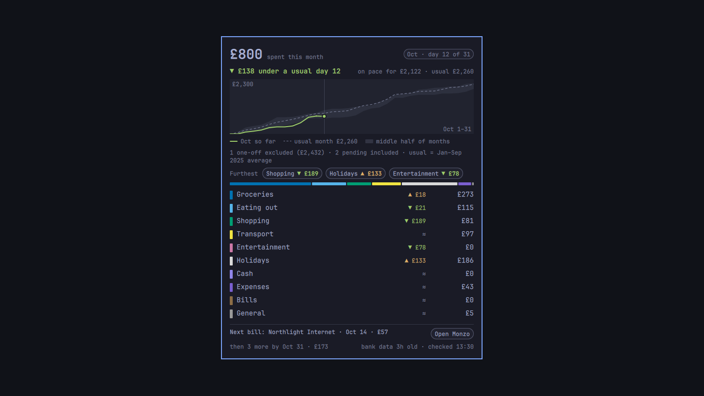

# Moth

**Moth: your Monzo spending on your Omarchy bar.** One butterfly, tinted by how this month's
spending is going against *your own* usual month. Hover it for a card with the whole picture;
click it to open Monzo. It only ever reads.

Moth is a **UK fork of [Pupa](https://github.com/nathankramm/omarchy-monarch-money)** (by Nathan
Kramm). Pupa read Monarch Money, which is US-only. Moth reads your **Monzo** account directly
through Monzo's own developer API — no aggregator, no server to run — and shows pounds, not
dollars. See [`docs/design.md`](docs/design.md) for the design decisions.

> **Unofficial.** Moth is not affiliated with Monzo. It talks to your own account through the
> community client [`Monzo-API`](https://pypi.org/project/Monzo-API/) and a Monzo OAuth client
> you create yourself. It is **read-only**: it only ever lists accounts and transactions.
> **Your tokens stay in your local keyring.** They are never written to a file, a log, the
> clipboard, or anything that leaves your machine.



## What you get

- **On the bar:** a butterfly and nothing else. Never a number, so a glance at your bar in a
  meeting gives nothing away.
- **On hover:** this month so far, the pace line (`▼ £138 under a usual day 12`), where the month
  is heading, a chart against your usual month, the three spending groups furthest from usual,
  every group with its own figure, and how fresh the data is.
- **On click:** Monzo opens in your browser (or the Monzo web app, if installed). Middle click
  fetches fresh data now.

The card has two pages. **Month** is the spending picture above. **Account** is the account
itself: balance, spent today, the balance with pots, every pot, and the **last seven days** of
transactions by day — merchant emoji, time, name, amount, and `pending` on anything not
settled. Switch with the two labels at the top of the card; hover always opens on Month.

The colours: **green** under or on your usual pace, **amber** over it (never red), **neutral** on
days 1–3 and while there is no complete month to compare with, **greyed** when the data is over 3
hours old, and a **broken-link glyph** when there is nothing trustworthy to show.

## What you need

1. **A Monzo current account.** Moth reads only your personal current account (`uk_retail`).
2. **A Monzo OAuth client**, made in a minute at [developers.monzo.com](https://developers.monzo.com/).
   Set its **Redirect URL** to `http://localhost:8080/callback` and its **Confidentiality** to
   *Confidential* (that is what earns a refresh token, so you stay signed in). Keep the client
   ID and secret for the login step.
3. A stock Omarchy (Python 3.11+, `secret-tool`, a running keyring — all present on Omarchy).

## Install

```sh
git clone https://github.com/silentjay/moth ~/.config/omarchy/plugins/io.github.silentjay.moth
cd ~/.config/omarchy/plugins/io.github.silentjay.moth
./install.sh                  # engine, private venv (hash-pinned), moth-now on your PATH
omarchy-shell io.github.silentjay.moth rescan      # or add the plugin from the Omarchy menu
```

`install.sh` needs `uv` (Omarchy ships it). Then connect your account:

```sh
moth-now login
```

It asks for the client ID, the client secret and the redirect URI (or take them from the
environment — `MOTH_MONZO_CLIENT_ID`, `MOTH_MONZO_CLIENT_SECRET`, `MOTH_MONZO_REDIRECT_URI`). It
opens your browser to Monzo; log in and approve access in the Monzo app (you will get a push
notification). Moth then stores the tokens in your keyring and pulls your **full history** right
away — Monzo only offers it for five minutes after you sign in, so Moth keeps a local ledger and
tops it up hourly from the last 90 days thereafter.

```sh
moth-now status     # what the engine knows, never an amount
moth-now check 2025-09-01 2025-09-30   # this engine's figure for a range, to compare with Monzo
moth-now logout     # forget the connection
```

## Configuration

Optional. Copy `config.example.toml` to `~/.config/moth-now/config.toml`. You can set the grace
period, the tag that marks a one-off purchase, further excluded tags, the first month the usual
month may use, and your own spending groups (`[[groups]]`). A value the engine cannot use is not
guessed at: the default stays in force and `moth-now status` says why.

By default the card's rows are Monzo's own spending categories folded into eight everyday groups
(see `engine/mothnow/groups.py`); a `[[groups]]` block replaces that map entirely.

## How it works

- `engine/mothnow/` — the engine. `adapter.py` is the **only** module that knows Monzo.
- Monzo returns the **last 90 days**, except in the five minutes after login; Moth's persistent
  ledger (`~/.cache/moth-now/ledger.json`) keeps the older months, so the usual month has depth.
- A transaction counts as spending when it is **negative** and Monzo counts it in spending
  (`include_in_spending`): pot moves and internal transfers are excluded, and money coming in
  (positive amounts) is not spending. A `#tag` in a transaction's notes excludes it.
- The usual month is computed from your own complete months, the newest twelve at most — never
  typed in.
- In Total: nothing leaves your machine but the calls to Monzo. No analytics, no cloud.

## Tests

```sh
./run-tests.sh                 # T9 (model vs an independent oracle) + T10 (the bar tick), each with mutants
python3 tools/demo.py --check  # the demo's own self-check
tools/open_test.sh             # the click paths, with nothing launched
```

`tools/demo.py` paints the widget with an invented household (no Monzo account needed); see its
`--help` for the `omarchy-shell io.github.silentjay.moth fixture …` scenes.

## What Moth does *not* do (yet)

- **HSBC.** Monzo's API sees Monzo only. Adding HSBC means an aggregator with an HTTPS callback;
  the planned path is a free Tailscale Funnel URL plus Enable Banking.
- **Recurring bills.** The card's bill line stays empty (Monzo exposes no schedules to this API).

## Credits

Pupa by [Nathan Kramm](https://github.com/nathankramm/omarchy-monarch-money) (MIT). Monzo access
via [`Monzo-API`](https://github.com/petermcd/monzo-api) by Peter McDonald (MIT). Moth is MIT.
